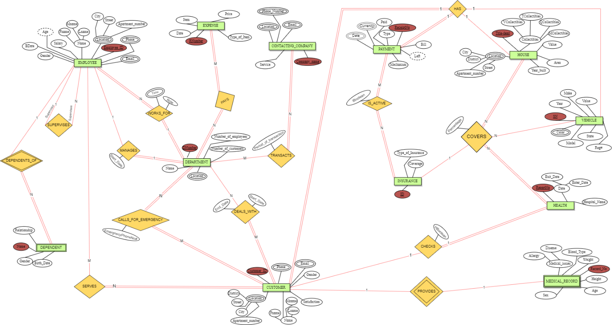

# Original coursework (2022)

The project as it was submitted, kept for reference. Nothing here is used by the build; the
working schema is in [`db/`](../../db) and the queries are in [`queries/`](../../queries).

| File | What it is |
|---|---|
| [`safe-hands-report-2022.pdf`](safe-hands-report-2022.pdf) | The full report (145 pages, December 2022): system description, ER diagram, relational mapping, Oracle DDL and data, ten scenario queries with results, and a normalization analysis. Formerly `DataBase Project.pdf`. |
| [`er-diagram-2022.png`](er-diagram-2022.png) | The ER diagram from page 4 of the report, extracted at full resolution. |
| [`oracle/01_schema.sql`](oracle/01_schema.sql) | The DDL from section VIII (pp. 36-49). |
| [`oracle/02_data.sql`](oracle/02_data.sql) | The INSERT statements from section X (pp. 59-76). |
| [`oracle/03_scenarios.sql`](oracle/03_scenarios.sql) | The ten scenario queries from section XI (pp. 100-115). |

The `oracle/` files are transcribed verbatim, errors included (curly quotes, trailing commas,
swapped columns, ...). The only edit is re-joining lines the PDF broke in the middle of a
statement. They are excluded from linting on purpose.

What is wrong with them, with evidence, is in [../errata.md](../errata.md); the tests in
[`tests/original/`](../../tests/original) run these files and reproduce each defect.

Authors: Bilal Delbani, Omar Temsah, Mohammad Al Fallah, Mohammad Alizzi
(Lebanese American University, December 2022).
