# Schema reference

<!-- Generated by `npm run docs` from the database catalog. Do not edit by hand:
     change the migrations (table and column comments live in
     db/migrations/20261014000003_document_schema.sql) and regenerate. -->

PostgreSQL 18. Every table, column and view below is documented in the database itself
(`\d+ table_name` in psql shows the same text). The **Original** column names the
corresponding table or column in the 2022 Oracle design; see [errata.md](errata.md) for
what changed and why, and [design-decisions.md](design-decisions.md) for the reasoning.

## Entity-relationship diagram

`||` exactly one, `|o` zero or one, `o{` zero or many. Labels are the foreign-key columns.

```mermaid
erDiagram
    employee ||--o| department : "manager_id"
    department ||--o{ employee : "dept_no"
    employee |o--o{ employee : "supervisor_id"
    department ||--o{ department_location : "dept_no"
    employee ||--o{ dependent : "employee_id"
    employee ||--o{ employee_address : "employee_id"
    employee ||--o{ employee_phone : "employee_id"
    employee ||--o{ employee_email : "employee_id"
    customer ||--o{ customer_address : "customer_id"
    customer ||--o{ customer_phone : "customer_id"
    customer ||--o{ customer_email : "customer_id"
    customer ||--o{ serves : "customer_id"
    employee ||--o{ serves : "employee_id"
    customer ||--o{ deals_with : "customer_id"
    department ||--o{ deals_with : "dept_no"
    customer ||--o{ calls_for_emergency : "customer_id"
    department ||--o{ calls_for_emergency : "dept_no"
    customer ||--o| medical_record : "customer_id"
    insurance |o--o{ vehicle : "insurance_id"
    customer ||--o{ vehicle : "owner_id"
    vehicle ||--o{ vehicle_color : "serial_no"
    insurance |o--o{ house : "insurance_id"
    customer ||--o{ house : "owner_id"
    customer ||--o| health_report : "customer_id"
    insurance ||--o{ health_report : "insurance_id"
    customer ||--o{ payment : "customer_id"
    payment ||--o{ payment_currency : "receipt_no"
    payment ||--o{ payment_date : "receipt_no"
    insurance ||--o{ payment_policy : "insurance_id"
    payment ||--o{ payment_policy : "receipt_no"
    department ||--o{ pays : "dept_no"
    expense ||--o{ pays : "expense_receipt_no"
    contracted_company ||--o{ contracted_company_location : "company_name"
    contracted_company ||--o{ contracted_company_phone : "company_name"
    contracted_company ||--o{ contracted_company_email : "company_name"
    contracted_company ||--o{ transacts : "company_name"
    department ||--o{ transacts : "dept_no"
    department {
        int dept_no PK
        varchar name
        int manager_id FK
        date manager_start_date
    }
    employee {
        int employee_id PK
        varchar first_name
        varchar middle_name
        varchar last_name
        numeric salary
        date birth_date
        varchar gender
        varchar role
        int supervisor_id FK
        int dept_no FK
    }
    department_location {
        int dept_no PK, FK
        varchar location PK
    }
    dependent {
        int employee_id PK, FK
        varchar name PK
        varchar gender
        date birth_date
        varchar relationship
    }
    employee_address {
        int address_id PK
        int employee_id FK
        varchar city
        varchar street
        int apartment_no
    }
    employee_phone {
        int employee_id PK, FK
        char phone PK
    }
    employee_email {
        int employee_id PK, FK
        varchar email PK
    }
    customer {
        int customer_id PK
        varchar first_name
        varchar middle_name
        varchar last_name
        smallint satisfaction
        varchar gender
    }
    customer_address {
        int address_id PK
        int customer_id FK
        varchar district
        varchar city
        varchar street
        int apartment_no
    }
    customer_phone {
        int customer_id PK, FK
        char phone PK
    }
    customer_email {
        int customer_id PK, FK
        varchar email PK
    }
    serves {
        int customer_id PK, FK
        int employee_id PK, FK
    }
    deals_with {
        int dept_no PK, FK
        int customer_id PK, FK
        date start_date
        date end_date
    }
    calls_for_emergency {
        int dept_no PK, FK
        int customer_id PK, FK
        char emergency_phone_no
    }
    medical_record {
        int customer_id PK, FK
        int record_no PK
        varchar blood_type
        numeric weight_kg
        numeric height_cm
        smallint age_years
        varchar disease
        varchar allergy
    }
    insurance {
        int insurance_id PK
        varchar insurance_type
        smallint coverage_pct
    }
    vehicle {
        int serial_no PK
        char plate_letter
        int registration_no
        smallint model_year
        varchar make
        varchar model
        numeric market_value
        int owner_id FK
        int insurance_id FK
        smallint coverage_pct
    }
    vehicle_color {
        int serial_no PK, FK
        varchar color PK
    }
    house {
        varchar title_deed PK
        numeric area_m2
        smallint year_built
        numeric market_value
        numeric collectibles_value
        varchar collectibles_type
        varchar collectibles_material
        int collectibles_quantity
        varchar district
        varchar city
        varchar street
        int apartment_no
        int owner_id FK
        int insurance_id FK
        smallint coverage_pct
    }
    health_report {
        int report_no PK
        int customer_id FK
        varchar hospital_name
        date admitted_on
        date discharged_on
        boolean checkup_done
        int insurance_id FK
        smallint coverage_pct
    }
    payment {
        int receipt_no PK
        int customer_id FK
        varchar payment_type
        varchar mechanism
        numeric bill
        numeric paid
        numeric amount_due
    }
    payment_currency {
        int receipt_no PK, FK
        varchar currency PK
    }
    payment_date {
        int receipt_no PK, FK
        date paid_on PK
    }
    payment_policy {
        int receipt_no PK, FK
        int insurance_id PK, FK
        boolean is_active
    }
    expense {
        int receipt_no PK
        varchar item
        varchar item_type
        numeric price
        date spent_on
    }
    pays {
        int dept_no PK, FK
        int expense_receipt_no PK, FK
    }
    contracted_company {
        varchar name PK
        varchar service
    }
    contracted_company_location {
        varchar company_name PK, FK
        varchar location PK
    }
    contracted_company_phone {
        varchar company_name PK, FK
        char phone PK
    }
    contracted_company_email {
        varchar company_name PK, FK
        varchar email PK
    }
    transacts {
        int dept_no PK, FK
        varchar company_name PK, FK
        smallint period_years
    }
```

## Tables

### `department`

A company department (DEPARTMENT, with MANAGES).

Original: DEPARTMENT

| Column | Type | Null | Key | Description | Original |
|---|---|---|---|---|---|
| `dept_no` | integer | no | PK | Department number. | DNumber |
| `name` | character varying(30) | no |  | Department name, unique. | DName |
| `manager_id` | integer | no | FK | Employee who manages the department (MANAGES, 1:1). Deferred FK. | EID |
| `manager_start_date` | date | no |  | When the current manager took over. | Manager_Start_Date |

Constraints:

- check `dept_no > 0`
- `manager_id` → `employee.employee_id`, deferrable initially deferred
- unique (`manager_id`)
- unique (`name`)

### `employee`

A company employee (EMPLOYEE, with SUPERVISES and WORKS_FOR).

Original: EMPLOYEE

| Column | Type | Null | Key | Description | Original |
|---|---|---|---|---|---|
| `employee_id` | integer | no | PK | Employee number. | Employee_ID |
| `first_name` | character varying(15) | no |  | First name. | Fname |
| `middle_name` | character varying(15) | no |  | Middle name. | Mname |
| `last_name` | character varying(15) | no |  | Last name. | Lname |
| `salary` | numeric(12,2) | no |  | Monthly salary; must exceed 5000. Default `6000`. | Salary |
| `birth_date` | date | yes |  | Date of birth; age is derived in employee_profile. | BDate |
| `gender` | character varying(6) | yes |  | Male or Female. | Gender |
| `role` | character varying(15) | no |  | Job title within the department (WORKS_FOR.Role). | Role |
| `supervisor_id` | integer | yes | FK | Supervising employee (SUPERVISES, 1:N). | Super_ID |
| `dept_no` | integer | no | FK | Department the employee works for (WORKS_FOR, N:1). | DNo (missing from the report's DDL) |

Constraints:

- check `employee_id > 9999`
- check `gender IN ('Male', 'Female')`
- check `supervisor_id <> employee_id`
- check `role IN ('CEO', 'Manager', 'Advisor', 'Secretary', 'Security', 'Trainer')`
- check `salary > 5000`
- `dept_no` → `department.dept_no`
- `supervisor_id` → `employee.employee_id`, on delete set null

### `department_location`

Locations of a department (multivalued attribute).

Original: DEPARTMENT_LOCATION

| Column | Type | Null | Key | Description | Original |
|---|---|---|---|---|---|
| `dept_no` | integer | no | PK, FK | Department. | DNumber |
| `location` | character varying(20) | no | PK | City or branch. | DLocation |

Constraints:

- `dept_no` → `department.dept_no`, on delete cascade

### `dependent`

Family member of an employee (weak entity, DEPENDENTS_OF).

Original: DEPENDENT

| Column | Type | Null | Key | Description | Original |
|---|---|---|---|---|---|
| `employee_id` | integer | no | PK, FK | Employee the dependent belongs to. | EID |
| `name` | character varying(15) | no | PK | First name; partial key. | Name |
| `gender` | character varying(6) | yes |  | Male or Female. | Gender |
| `birth_date` | date | yes |  | Date of birth. | BDate |
| `relationship` | character varying(10) | no |  | Relationship to the employee. | Relationship |

Constraints:

- check `gender IN ('Male', 'Female')`
- check `relationship IN ('Son', 'Daughter', 'Husband', 'Wife', 'Mother', 'Father', 'Brother', 'Sister')`
- `employee_id` → `employee.employee_id`, on delete cascade

### `employee_address`

Addresses of an employee (multivalued composite attribute).

Original: EMPLOYEE_LOCATION

| Column | Type | Null | Key | Description | Original |
|---|---|---|---|---|---|
| `address_id` | integer | no | PK | Surrogate key. Identity. | new |
| `employee_id` | integer | no | FK | Employee. | Employee_ID |
| `city` | character varying(20) | no |  | City or town. | ECity |
| `street` | character varying(20) | yes |  | Street. | EStreet |
| `apartment_no` | integer | yes |  | Apartment number. | EApartment_number |

Constraints:

- check `apartment_no > 0`
- `employee_id` → `employee.employee_id`, on delete cascade
- unique (`employee_id, city, street, apartment_no`), nulls not distinct

### `employee_phone`

Phone numbers of an employee (multivalued attribute).

Original: EMPLOYEE_PHONE

| Column | Type | Null | Key | Description | Original |
|---|---|---|---|---|---|
| `employee_id` | integer | no | PK, FK | Employee. | Employee_ID |
| `phone` | character(8) | no | PK | 8-digit Lebanese phone number. | EPhone |

Constraints:

- check `phone ~ '^[0-9]{8}$'`
- `employee_id` → `employee.employee_id`, on delete cascade

### `employee_email`

Email addresses of an employee (multivalued attribute).

Original: EMPLOYEE_EMAIL

| Column | Type | Null | Key | Description | Original |
|---|---|---|---|---|---|
| `employee_id` | integer | no | PK, FK | Employee. | Employee_ID |
| `email` | character varying(50) | no | PK | Email address. | EEmail |

Constraints:

- check `email ~ '^[^@[:space:]]+@[^@[:space:]]+\.[^@[:space:]]+$'`
- `employee_id` → `employee.employee_id`, on delete cascade

### `customer`

An insurance customer.

Original: CUSTOMER

| Column | Type | Null | Key | Description | Original |
|---|---|---|---|---|---|
| `customer_id` | integer | no | PK | Customer number. | Customer_ID |
| `first_name` | character varying(15) | no |  | First name. | Fname |
| `middle_name` | character varying(15) | no |  | Middle name. | Mname |
| `last_name` | character varying(15) | no |  | Last name. | Lname |
| `satisfaction` | smallint | yes |  | Satisfaction score from 0 to 10. | Satisfaction |
| `gender` | character varying(6) | no |  | Male or Female. | Gender |

Constraints:

- check `customer_id > 9999`
- check `gender IN ('Male', 'Female')`
- check `(satisfaction >= 0) AND (satisfaction <= 10)`

### `customer_address`

Addresses of a customer (multivalued composite attribute).

Original: CUSTOMER_LOCATION

| Column | Type | Null | Key | Description | Original |
|---|---|---|---|---|---|
| `address_id` | integer | no | PK | Surrogate key. Identity. | new |
| `customer_id` | integer | no | FK | Customer. | Customer_ID |
| `district` | character varying(20) | no |  | District. | CDistrict |
| `city` | character varying(20) | no |  | City or town. | CCity |
| `street` | character varying(20) | yes |  | Street. | CStreet |
| `apartment_no` | integer | yes |  | Apartment number. | CApartment_number |

Constraints:

- check `apartment_no > 0`
- `customer_id` → `customer.customer_id`, on delete cascade
- unique (`customer_id, district, city, street, apartment_no`), nulls not distinct

### `customer_phone`

Phone numbers of a customer (multivalued attribute).

Original: CUSTOMER_PHONE

| Column | Type | Null | Key | Description | Original |
|---|---|---|---|---|---|
| `customer_id` | integer | no | PK, FK | Customer. | Customer_ID |
| `phone` | character(8) | no | PK | 8-digit Lebanese phone number. | CPhone |

Constraints:

- check `phone ~ '^[0-9]{8}$'`
- `customer_id` → `customer.customer_id`, on delete cascade

### `customer_email`

Email addresses of a customer (multivalued attribute).

Original: CUSTOMER_EMAIL

| Column | Type | Null | Key | Description | Original |
|---|---|---|---|---|---|
| `customer_id` | integer | no | PK, FK | Customer. | Customer_ID |
| `email` | character varying(50) | no | PK | Email address. | CEmail |

Constraints:

- check `email ~ '^[^@[:space:]]+@[^@[:space:]]+\.[^@[:space:]]+$'`
- `customer_id` → `customer.customer_id`, on delete cascade

### `serves`

Which employees serve which customers (SERVES, M:N).

Original: SERVES

| Column | Type | Null | Key | Description | Original |
|---|---|---|---|---|---|
| `customer_id` | integer | no | PK, FK | Customer. | CustID |
| `employee_id` | integer | no | PK, FK | Employee. | EID |

Constraints:

- `customer_id` → `customer.customer_id`, on delete cascade
- `employee_id` → `employee.employee_id`, on delete cascade

### `deals_with`

Departments a customer deals with, and for how long (DEALS_WITH).

Original: DEALS_WITH

| Column | Type | Null | Key | Description | Original |
|---|---|---|---|---|---|
| `dept_no` | integer | no | PK, FK | Department. | DNo |
| `customer_id` | integer | no | PK, FK | Customer. | Customer_Number |
| `start_date` | date | no |  | Start of the service period. | Start_Date |
| `end_date` | date | no |  | End of the service period. | End_Date |

Constraints:

- check `end_date >= start_date`
- `customer_id` → `customer.customer_id`, on delete cascade
- `dept_no` → `department.dept_no`, on delete cascade

### `calls_for_emergency`

Emergency hotlines between customers and departments (CALLS_FOR_EMERGENCY, M:N).

Original: CALLS_FOR_EMERGENCY

| Column | Type | Null | Key | Description | Original |
|---|---|---|---|---|---|
| `dept_no` | integer | no | PK, FK | Department. | DNum |
| `customer_id` | integer | no | PK, FK | Customer. | CNum |
| `emergency_phone_no` | character(3) | no |  | 3-digit emergency number. | EmergencyPhoneNo# |

Constraints:

- check `emergency_phone_no ~ '^[0-9]{3}$'`
- `customer_id` → `customer.customer_id`, on delete cascade
- `dept_no` → `department.dept_no`, on delete cascade

### `medical_record`

Medical record of a customer (weak entity, PROVIDES, 1:1).

Original: MEDICAL_RECORD

| Column | Type | Null | Key | Description | Original |
|---|---|---|---|---|---|
| `customer_id` | integer | no | PK, FK | Customer the record belongs to. | CID |
| `record_no` | integer | no | PK | Record number; partial key. | RecordNo |
| `blood_type` | character varying(3) | no |  | ABO/Rh blood type. Default `'O+'::character varying`. | Blood_Type |
| `weight_kg` | numeric(5,1) | no |  | Weight in kilograms. | Weight |
| `height_cm` | numeric(5,1) | no |  | Height in centimetres. | Height |
| `age_years` | smallint | no |  | Age when the record was taken. | Age |
| `disease` | character varying(20) | yes |  | Known disease, if any. | Disease |
| `allergy` | character varying(20) | yes |  | Known allergy or symptom, if any. | Allergy |

Constraints:

- check `(age_years >= 1) AND (age_years <= 130)`
- check `blood_type IN ('A+', 'A-', 'B+', 'B-', 'AB+', 'AB-', 'O+', 'O-')`
- check `height_cm >= 40`
- check `record_no > 0`
- check `weight_kg >= 3`
- `customer_id` → `customer.customer_id`, on delete cascade
- unique (`customer_id`)

### `insurance`

An insurance policy type.

Original: INSURANCE

| Column | Type | Null | Key | Description | Original |
|---|---|---|---|---|---|
| `insurance_id` | integer | no | PK | Policy number. | IID |
| `insurance_type` | character varying(20) | no |  | Mandatory, Against others, or Other. | Type_of_Insurance |
| `coverage_pct` | smallint | no |  | Default coverage, 30-100%. Default `30`. | Coverage |

Constraints:

- check `(coverage_pct >= 30) AND (coverage_pct <= 100)`
- check `insurance_id > 0`
- check `insurance_type IN ('Mandatory', 'Against others', 'Other')`

### `vehicle`

An insured vehicle (with HAS and COVERS).

Original: VEHICLE

| Column | Type | Null | Key | Description | Original |
|---|---|---|---|---|---|
| `serial_no` | integer | no | PK | Serial number. | SN |
| `plate_letter` | character(1) | yes |  | Letter on the Lebanese plate. | State |
| `registration_no` | integer | yes |  | Plate number; unique together with the letter. | Reg# |
| `model_year` | smallint | no |  | Year of manufacture. | Year |
| `make` | character varying(15) | no |  | Manufacturer. | Make |
| `model` | character varying(15) | no |  | Model. | Model |
| `market_value` | numeric(12,2) | no |  | Market value. | Value |
| `owner_id` | integer | no | FK | Owning customer (HAS, 1:N). | CUSTOMER.VSN and HAS3 |
| `insurance_id` | integer | yes | FK | Covering policy (COVERS, 1:N). | IID and COVERS3 |
| `coverage_pct` | smallint | yes |  | Coverage for this vehicle, 30-100%. | Percentage |

Constraints:

- check `(insurance_id IS NULL) = (coverage_pct IS NULL)`
- check `(coverage_pct >= 30) AND (coverage_pct <= 100)`
- check `market_value > 0`
- check `model_year >= 1886`
- check `plate_letter ~ '^[A-Z]$'`
- check `registration_no > 0`
- check `serial_no > 99999`
- `insurance_id` → `insurance.insurance_id`
- `owner_id` → `customer.customer_id`
- unique (`plate_letter, registration_no`)

### `vehicle_color`

Colours of a vehicle (multivalued attribute).

Original: VEHICLE_COLOR

| Column | Type | Null | Key | Description | Original |
|---|---|---|---|---|---|
| `serial_no` | integer | no | PK, FK | Vehicle. | SN |
| `color` | character varying(10) | no | PK | Colour. | VCOLOR |

Constraints:

- `serial_no` → `vehicle.serial_no`, on delete cascade

### `house`

An insured house (with HAS and COVERS).

Original: HOUSE and HOUSE_LOCATION

| Column | Type | Null | Key | Description | Original |
|---|---|---|---|---|---|
| `title_deed` | character varying(100) | no | PK | Title deed number. | Title_dead |
| `area_m2` | numeric(8,2) | no |  | Floor area in square metres. | Area |
| `year_built` | smallint | no |  | Year built. | Year_built |
| `market_value` | numeric(12,2) | no |  | Market value; must exceed 5000. | Value |
| `collectibles_value` | numeric(12,2) | yes |  | Value of insured collectibles. | VCollectibles |
| `collectibles_type` | character varying(30) | yes |  | Kind of collectibles. | TCollectibles |
| `collectibles_material` | character varying(30) | yes |  | Material of the collectibles. | MCollectibles |
| `collectibles_quantity` | integer | yes |  | Number of collectible items. | QCollectibles |
| `district` | character varying(20) | no |  | District. | HOUSE_LOCATION.HDistrict |
| `city` | character varying(20) | no |  | City or town. | HOUSE_LOCATION.HCity |
| `street` | character varying(20) | yes |  | Street. | HOUSE_LOCATION.HStreet |
| `apartment_no` | integer | yes |  | Apartment number. | HOUSE_LOCATION.HApartment_Number |
| `owner_id` | integer | no | FK | Owning customer (HAS, 1:N). | CUSTOMER.HTitle and HAS2 |
| `insurance_id` | integer | yes | FK | Covering policy (COVERS, 1:N). | IID and COVERS2 |
| `coverage_pct` | smallint | yes |  | Coverage for this house, 30-100%. | Percentage |

Constraints:

- check `apartment_no > 0`
- check `area_m2 > 0`
- check `collectibles_quantity > 0`
- check `collectibles_value >= 0`
- check `(insurance_id IS NULL) = (coverage_pct IS NULL)`
- check `(coverage_pct >= 30) AND (coverage_pct <= 100)`
- check `market_value > 5000`
- `insurance_id` → `insurance.insurance_id`
- `owner_id` → `customer.customer_id`

### `health_report`

A hospital stay of a customer (CHECKS 1:1, COVERS).

Original: HEALTH

| Column | Type | Null | Key | Description | Original |
|---|---|---|---|---|---|
| `report_no` | integer | no | PK | Report number. | ReportNo |
| `customer_id` | integer | no | FK | Patient (CHECKS, 1:1). | CID |
| `hospital_name` | character varying(30) | no |  | Hospital. | Hospital_Name |
| `admitted_on` | date | no |  | Admission date. | Enter_Date |
| `discharged_on` | date | no |  | Discharge date. | Exit_Date |
| `checkup_done` | boolean | no |  | Whether a health check was done. Default `false`. | HBoolean |
| `insurance_id` | integer | no | FK | Covering policy (COVERS, 1:N). | IID and COVERS1 |
| `coverage_pct` | smallint | no |  | Coverage for this stay, 30-100%. | Percentage |

Constraints:

- check `(coverage_pct >= 30) AND (coverage_pct <= 100)`
- check `report_no > 0`
- check `discharged_on >= admitted_on`
- `customer_id` → `customer.customer_id`
- `insurance_id` → `insurance.insurance_id`
- unique (`customer_id`)

### `payment`

A customer payment (with HAS).

Original: PAYMENT

| Column | Type | Null | Key | Description | Original |
|---|---|---|---|---|---|
| `receipt_no` | integer | no | PK | Receipt number. | ReceiptNo |
| `customer_id` | integer | no | FK | Paying customer (HAS, 1:N). | CID and HAS1 |
| `payment_type` | character varying(15) | no |  | INSTALLMENT or LUMP SUM. | Type |
| `mechanism` | character varying(20) | no |  | Cash, bank transfer, credit card or bond. | Mechanism |
| `bill` | numeric(12,2) | no |  | Total amount owed. | Bill |
| `paid` | numeric(12,2) | no |  | Amount paid so far; at most the bill. Default `0`. | Paid |
| `amount_due` | numeric(12,2) | yes |  | bill - paid, generated. Generated: `(bill - paid)`. | derived attribute Left |

Constraints:

- check `bill > 0`
- check `mechanism IN ('CASH', 'BANK', 'CREDIT CARD', 'BOND')`
- check `paid <= bill`
- check `paid >= 0`
- check `payment_type IN ('INSTALLMENT', 'LUMP SUM')`
- check `receipt_no > 0`
- `customer_id` → `customer.customer_id`

### `payment_currency`

Currencies a payment was made in (multivalued attribute).

Original: PAYMENT_CURRENCY

| Column | Type | Null | Key | Description | Original |
|---|---|---|---|---|---|
| `receipt_no` | integer | no | PK, FK | Payment. | ReceiptNo |
| `currency` | character varying(10) | no | PK | Dollar, Euro, Lira or Dirham. | Currency |

Constraints:

- check `currency IN ('Dollar', 'Euro', 'Lira', 'Dirham')`
- `receipt_no` → `payment.receipt_no`, on delete cascade

### `payment_date`

Dates on which a payment was made (multivalued attribute).

Original: PAYMENT_DATE

| Column | Type | Null | Key | Description | Original |
|---|---|---|---|---|---|
| `receipt_no` | integer | no | PK, FK | Payment. | ReceiptNo |
| `paid_on` | date | no | PK | Payment date. | PDate |

Constraints:

- `receipt_no` → `payment.receipt_no`, on delete cascade

### `payment_policy`

Policies a payment is for, and whether each is active (IS_ACTIVE, M:N).

Original: IS_ACTIVE

| Column | Type | Null | Key | Description | Original |
|---|---|---|---|---|---|
| `receipt_no` | integer | no | PK, FK | Payment. | PNum |
| `insurance_id` | integer | no | PK, FK | Policy. | Insurance_ID |
| `is_active` | boolean | no |  | Whether the policy is still active. | IBoolean |

Constraints:

- `insurance_id` → `insurance.insurance_id`
- `receipt_no` → `payment.receipt_no`, on delete cascade

### `expense`

Something the company paid for.

Original: EXPENSE

| Column | Type | Null | Key | Description | Original |
|---|---|---|---|---|---|
| `receipt_no` | integer | no | PK | Receipt number. | RNumber |
| `item` | character varying(30) | no |  | What was bought. | Item |
| `item_type` | character varying(30) | no |  | Expense category. | Type_of_Item |
| `price` | numeric(12,2) | no |  | Amount paid. | Price |
| `spent_on` | date | no |  | Date of the expense. | Date |

Constraints:

- check `price > 0`
- check `receipt_no > 0`

### `pays`

Which departments paid which expenses (PAYS, M:N).

Original: PAYS

| Column | Type | Null | Key | Description | Original |
|---|---|---|---|---|---|
| `dept_no` | integer | no | PK, FK | Department. | DNum |
| `expense_receipt_no` | integer | no | PK, FK | Expense. | ERNum |

Constraints:

- `dept_no` → `department.dept_no`, on delete cascade
- `expense_receipt_no` → `expense.receipt_no`, on delete cascade

### `contracted_company`

A partner company that provides insured services.

Original: CONTRACTING_COMPANY

| Column | Type | Null | Key | Description | Original |
|---|---|---|---|---|---|
| `name` | character varying(30) | no | PK | Company name. | CName |
| `service` | character varying(20) | no |  | Vehicles, Houses or Health. | Service |

Constraints:

- check `service IN ('Vehicles', 'Houses', 'Health')`

### `contracted_company_location`

Branches of a partner company (multivalued attribute).

Original: CCOMPANIES_LOCATION

| Column | Type | Null | Key | Description | Original |
|---|---|---|---|---|---|
| `company_name` | character varying(30) | no | PK, FK | Company. | Company_name |
| `location` | character varying(20) | no | PK | City or branch. | CCLocation |

Constraints:

- `company_name` → `contracted_company.name`, on update cascade on delete cascade

### `contracted_company_phone`

Phone numbers of a partner company (multivalued attribute).

Original: CCOMPANIES_PHONE_NUMBER

| Column | Type | Null | Key | Description | Original |
|---|---|---|---|---|---|
| `company_name` | character varying(30) | no | PK, FK | Company. | Company_name |
| `phone` | character(8) | no | PK | 8-digit Lebanese phone number. | CCPhone_Number |

Constraints:

- check `phone ~ '^[0-9]{8}$'`
- `company_name` → `contracted_company.name`, on update cascade on delete cascade

### `contracted_company_email`

Email addresses of a partner company (multivalued attribute).

Original: CCOMPANIES_EMAIL

| Column | Type | Null | Key | Description | Original |
|---|---|---|---|---|---|
| `company_name` | character varying(30) | no | PK, FK | Company. | Company_name |
| `email` | character varying(50) | no | PK | Email address. | CCEmail |

Constraints:

- check `email ~ '^[^@[:space:]]+@[^@[:space:]]+\.[^@[:space:]]+$'`
- `company_name` → `contracted_company.name`, on update cascade on delete cascade

### `transacts`

Contracts between departments and partner companies (TRANSACTS, M:N).

Original: TRANSACTS

| Column | Type | Null | Key | Description | Original |
|---|---|---|---|---|---|
| `dept_no` | integer | no | PK, FK | Department. | DNo |
| `company_name` | character varying(30) | no | PK, FK | Company. | Company_Name |
| `period_years` | smallint | no |  | Contract length in years. Default `1`. | Period_of_transaction |

Constraints:

- check `period_years >= 1`
- `company_name` → `contracted_company.name`, on update cascade on delete cascade
- `dept_no` → `department.dept_no`, on delete cascade

## Views

### `employee_profile`

Employees with their derived age and department name. New.

Columns: `employee_id`, `first_name`, `middle_name`, `last_name`, `gender`, `birth_date`, `age`, `role`, `salary`, `dept_no`, `department`, `supervisor_id`

### `department_summary`

Departments with derived employee and customer counts (replaces the stored Number_of_employees/customers).

Columns: `dept_no`, `name`, `manager_id`, `manager_start_date`, `employee_count`, `customer_count`
